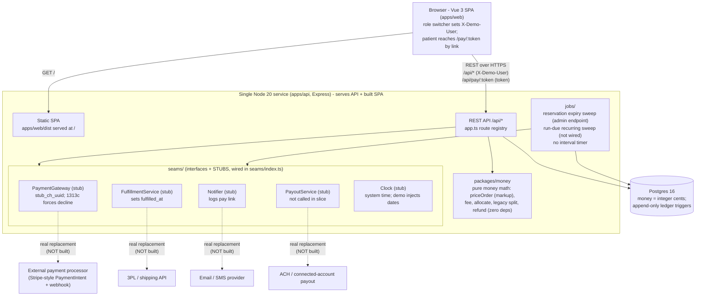
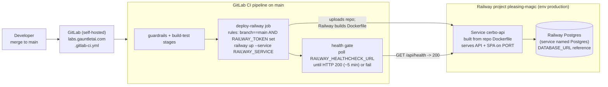
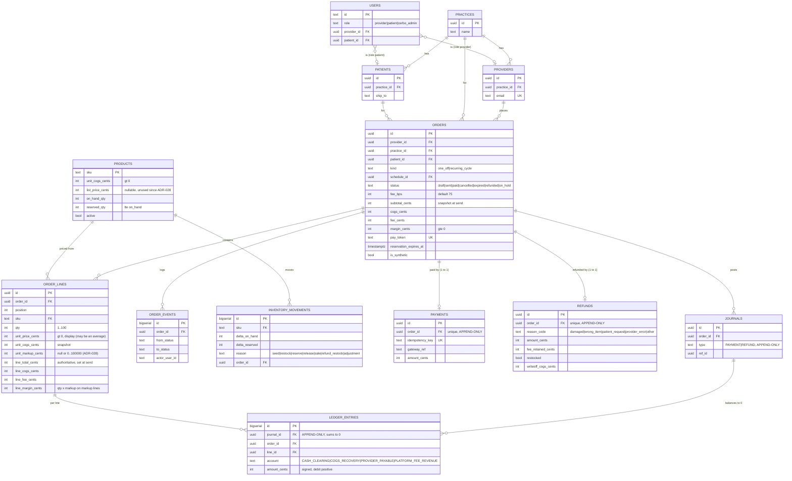
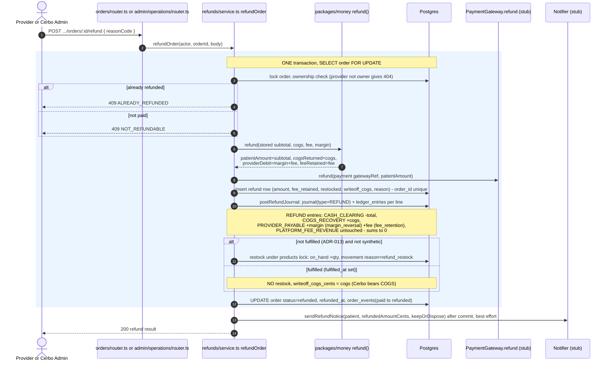
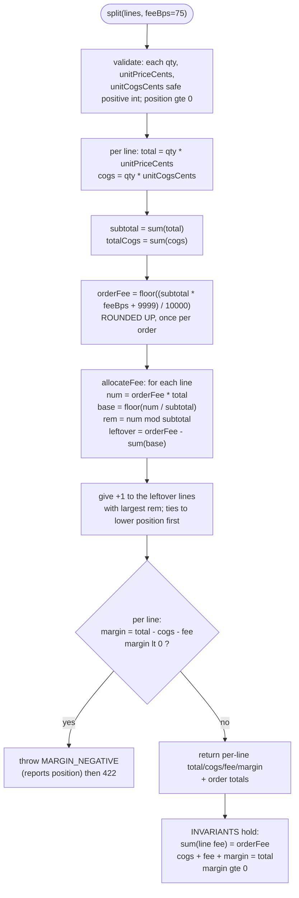
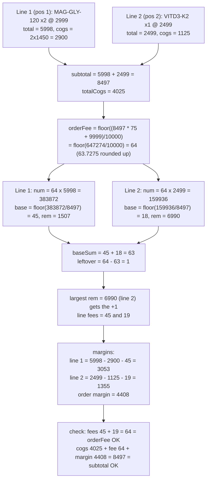

# DIAGRAMS.md - Architecture and sequence diagrams

These diagrams describe the system **as merged on `main`**, not the aspiration, and have
been re-checked against the code (ADR-028 markup pricing, payments, refunds, jobs). Every
diagram cites the source file(s) a reader can check it against.

Rendering: all diagrams are Mermaid fenced code blocks, which GitLab renders natively. No
image files, no external tooling, no new dependencies.

See the "Status" section at the end for the merged / not-built breakdown.

---

## 1. System architecture (container level)

One deployable Node service serves both the REST API and the built Vue SPA, backed by a
single Postgres. All external dependencies are reached only through seam interfaces whose
current implementations are in-process stubs (AGENTS.md section 6).



Source: `apps/api/src/app.ts`, `apps/api/src/seams/` (`index.ts`, `paymentGateway.ts`,
`fulfillment.ts`, `notifier.ts`, `payout.ts`, `clock.ts`), `apps/api/src/jobs/expire.ts`,
`apps/api/src/jobs/recurring.ts`, `apps/api/src/server.ts`, `apps/web/src/router.ts`. Dashed arrows are the real-service replacements from
`docs/ARCHITECTURE.md` section 7 - none are built; every seam is an in-process stub today.

### Deployment shape (Railway)

Railway cannot source builds from self-hosted GitLab (its native deploy-on-push is
GitHub-only), so GitLab CI pushes the build to Railway with `railway up` instead.



Source: `.gitlab-ci.yml` (`deploy-railway` job), `railway.json`, `Dockerfile`,
`docs/DEPLOY.md`. `railway up` returns at queue time, so the health poll (not the `up`
exit code) is the real deploy gate. A merge to `main` is what triggers a deploy.

---

## 2. Data model (entity relationship)

The real tables from T2's five migrations (merged, gate G2) plus the later additive
migrations (list price, price history, refund requests, ADR-028 markup). Money columns are
integer cents. Append-only tables are marked; DB triggers (migration 5) reject UPDATE on them and
reject DELETE unless a synthetic-purge flag is set (`payable_statements` is never
deletable). A deferred constraint trigger makes each journal's `ledger_entries` sum to
zero at commit.



Append-only and trigger-protected (migration 5): `journals`, `ledger_entries`,
`payments`, `refunds`, `payable_statements`. UPDATE is always rejected; DELETE is rejected
unless the row is `is_synthetic` and the guarded purge flag is on, except
`payable_statements`, which is never deletable.

Also in the schema, with live feature code, but omitted from the ER diagram above only
for readability: `recurring_schedules` and `schedule_lines` (recurring, T9;
`schedule_lines.unit_markup_cents` NOT NULL 0..100000, ADR-028), `payable_statements`
(payables close), `baseline_imports` and `baseline_orders` (baseline/migration, admin),
`refund_requests` (patient refund requests, ADR-026/027: one pending per order,
`review_token` unique) and `product_price_changes` (append-only list-price history,
ADR-025; no longer written since ADR-028). Full columns: `docs/ARCHITECTURE.md` section 3.

Source: `apps/api/src/db/migrations/20261005120001_reference_and_catalog.ts`,
`20261005120002_orders_and_inventory.ts`, `20261005120003_ledger.ts`,
`20261005120004_reports_and_baseline.ts`, `20261005120005_protections.ts`,
`20261006120001_product_list_price.ts`, `20261007120001_product_price_changes.ts`,
`20261007120002_refund_requests.ts`, `20261007120003_refund_request_review.ts`,
`20261007120004_markup_pricing.ts`.

---

## 3. Sequence - order creation to send

Provider builds a draft, adds lines with a per-unit dollar markup (the server derives the
price as COGS + markup + fee, ADR-028), watches the live server-computed quote, then sends. Send takes a `products`
row lock, snapshots COGS, re-derives each line's price from that COGS + its markup, and
writes the computed split onto the order and lines, reserves stock
with a 7-day expiry, and moves the order to `sent`. All split math is in `packages/money`
and runs server-side; the UI never computes fees, margins, or allocations.

```mermaid
sequenceDiagram
  autonumber
  actor Prov as Provider (SPA)
  participant API as orders/router.ts
  participant Svc as orders/service.ts
  participant Money as packages/money (priceOrder, split)
  participant Inv as inventory/service.ts
  participant DB as Postgres
  participant Notif as Notifier (stub)

  Prov->>API: POST /api/orders { patientId }
  API->>Svc: createDraft(actor, body)
  Svc->>DB: verify patient in actor practice (else 404)
  Svc->>DB: insert order (status=draft) + order_events(to draft)
  API-->>Prov: 201 OrderView (status draft)

  Prov->>API: POST /api/orders/:id/lines { sku, qty, markupCents }
  Note over API,Svc: unitPriceCents or marginBps then 400 INVALID_INPUT (retired)
  API->>Svc: addLine(...)
  Svc->>DB: load product (catalog COGS)
  Svc->>Money: priceOrder([line], fee_bps) for the line alone (draft display price)
  Money-->>Svc: total = ceil(qty x (COGS + markup) / (1 - fee)), fee rounded up
  Svc->>DB: merge or insert line (qty sums for same SKU)
  Note over Svc,Inv: add-to-cart stock gate: available = on_hand - reserved
  Svc->>Money: priceOrder(lines, fee_bps) re-price whole cart (split() for legacy lines)
  Money-->>Svc: throws MARGIN_NEGATIVE then 422 rollback if any line lt 0
  API-->>Prov: 200 OrderView

  Prov->>API: GET /api/orders/:id/quote
  API->>Svc: getQuote(...)
  Svc->>Money: priceOrder(lines, fee_bps) using LIVE catalog COGS (draft)
  Money-->>Svc: totals + per-line fee/margin
  API-->>Prov: 200 live split preview

  Prov->>API: POST /api/orders/:id/send
  API->>Svc: sendOrder(actor, id, seams)
  Svc->>Svc: clock.now(); expiresAt = now + 7 days; pay_token = randomBytes(24).base64url
  rect rgb(235,245,255)
    Note over Svc,DB: ONE transaction with products row lock (FOR UPDATE, ordered by sku)
    Svc->>DB: SELECT products FOR UPDATE (snapshot COGS now, ADR-006)
    Svc->>Money: priceOrder(snapshot COGS + markup per line, fee_bps), order rounded once
    Money-->>Svc: per-line total/cogs/fee/margin (or MARGIN_NEGATIVE then rollback)
    Svc->>Inv: reserveLines(...) re-check available, inc reserved_qty, write reserve movement
    Note over Inv,DB: INSUFFICIENT_STOCK then rollback, nothing reserved
    Svc->>DB: UPDATE order_lines (snapshot + split); UPDATE orders status=sent, totals, pay_token, reservation_expires_at
    Svc->>DB: insert order_events(draft to sent)
  end
  Svc->>Notif: sendPayLink(patient, /pay/:token) after commit
  API-->>Prov: 200 { order, payUrl = /pay/:token }
```

Source: `apps/api/src/orders/service.ts` (`createDraft`, `addLine`, `updateLine`,
`getQuote`, `sendOrder`), `apps/api/src/orders/router.ts`,
`apps/api/src/inventory/service.ts` (`reserveLines`, `availableOf`),
`apps/api/src/orders/pricing.ts` (`priceLines`, `standaloneUnitPrice`),
`packages/money/src/priceOrder.ts`, `packages/money/src/split.ts`,
`packages/money/src/pricing.ts`. Reservation lifetime `RESERVATION_DAYS = 7` is in
`orders/service.ts`.

---

## 4. Sequence - patient payment and ledger posting

This is the most important flow in the document. The patient route uses the unguessable
`pay_token` in the URL, never `X-Demo-User`. The status change, ledger posting, and
inventory change happen in ONE transaction under a `SELECT ... FOR UPDATE` row lock on the
order. The amount charged is the order's stored snapshot subtotal, and the journal is
posted from the stored per-line split (set at send); nothing is re-priced at payment and
any client-sent price is ignored.

```mermaid
sequenceDiagram
  autonumber
  actor Pat as Patient (via pay link)
  participant API as payments/router.ts
  participant Svc as payments/service.ts (pay, recordPaymentSucceeded)
  participant DB as Postgres
  participant Gw as PaymentGateway (stub)
  participant Led as ledger/post.ts postPaymentJournal

  Pat->>API: GET /api/pay/:token
  API->>DB: load order by pay_token
  API-->>Pat: 200 whitelist only (items name/qty/unitPrice/lineTotal, totalCents, status, patientFirstName)
  Note over API,Pat: no cogs, fee, margin, or provider economics (EVAL-12)

  Pat->>API: POST /api/pay/:token { idempotencyKey }
  API->>Svc: pay(token, body) ignore any client-sent amount (money rule 9)

  rect rgb(235,245,255)
    Note over Svc,DB: ONE transaction, SELECT order FOR UPDATE (ADR-008, money rule 8)
    Svc->>DB: lock order row by pay_token
    alt paid + same idempotencyKey
      Svc-->>Pat: 200 original result (no second charge)
    else paid + other key / expired / not sent / reservation lapsed
      Svc-->>Pat: 409 ALREADY_PAID / ORDER_EXPIRED / ORDER_NOT_PAYABLE
    end
    Svc->>Gw: charge(snapshot subtotal_cents, idempotencyKey)
    alt declined (amount == 1313c stub trigger)
      Gw-->>Svc: declined
      Svc-->>Pat: 402 PAYMENT_DECLINED - rollback: order stays sent, NO payment, NO journal
    else succeeded
      Gw-->>Svc: stub_ch_uuid
      Svc->>DB: insert payment (order_id unique, idempotency_key unique - reuse on another order gives 409 IDEMPOTENCY_CONFLICT)
      Svc->>DB: inventory sale under products lock: on_hand -qty, reserved -qty, movement reason=sale
      Svc->>Led: postPaymentJournal(stored line_total/cogs/fee/margin per line)
      Led->>DB: insert journal(type=PAYMENT) + ledger_entries per line
      Note over Led,DB: per line, debit positive, credit negative:<br/>CASH_CLEARING +total, COGS_RECOVERY -cogs,<br/>PROVIDER_PAYABLE -margin, PLATFORM_FEE_REVENUE -fee
      Svc->>DB: UPDATE order status=paid, paid_at; order_events(sent to paid)
      Note over DB: deferred trigger verifies journal balance = 0 at COMMIT
    end
  end
  Svc-->>Pat: 200 { paymentId, status paid, totalCents, paidAt } (patient-safe)
```

Per-line PAYMENT journal (sign convention debit positive, from `docs/ARCHITECTURE.md`
section 5):

| Account | Amount |
|---|---|
| CASH_CLEARING | +total |
| COGS_RECOVERY | -cogs |
| PROVIDER_PAYABLE | -margin |
| PLATFORM_FEE_REVENUE | -fee |

Every journal sums to zero and is enforced at commit by the deferred
`ledger_entries_balanced` trigger (migration 5). Recurring cycles reuse the same
`postPaymentJournal`; synthetic demo orders (`admin/demo/migration.ts`) also post through it
but never touch inventory.

Source: `apps/api/src/payments/router.ts`, `apps/api/src/payments/service.ts` (`pay`,
`recordPaymentSucceeded`), `apps/api/src/ledger/post.ts` (`postPaymentJournal`),
`apps/api/src/seams/paymentGateway.ts` (`DECLINE_AMOUNT_CENTS = 1313`),
`apps/api/src/db/migrations/20261005120005_protections.ts` (zero-sum trigger).

---

## 5. Sequence - refund

`POST /api/orders/:id/refund` (provider, own orders) and `POST /api/admin/orders/:id/refund`
(Cerbo Admin, any order) share `refunds/service.ts` `refundOrder`. A patient refund request
approved by the provider (`/api/orders/:id/refund-request/approve` or the
`/api/refund-review/:token/accept` link, ADR-027) runs the same function with the request's
reason code. Rules: ADR-012 (patient gets 100% back; platform fee retained and charged to
the provider), ADR-013 (restock before fulfilment, write off after), ADR-014 (whole-order
only), ADR-023 as amended by ADR-027 (unopened products may be returned within 30 days; shipped returns are written off).



ADR-012: the patient receives 100% of the subtotal; `PLATFORM_FEE_REVENUE` is NOT reversed
on a refund, so the provider absorbs the fee and Cerbo keeps it (the provider ends at
`-fee` for that order). ADR-013: a pre-fulfilment refund restocks; a post-fulfilment refund
writes off the COGS and Cerbo bears it. Whole-order refunds only (ADR-014).

Source: `apps/api/src/refunds/service.ts` (`refundOrder`), `apps/api/src/refunds/posting.ts`
(`postRefundJournal`), `packages/money/src/refund.ts`, `apps/api/src/orders/router.ts`,
`apps/api/src/admin/operations/router.ts`, `apps/api/src/refund-requests/service.ts`.
Rules: `docs/DECISIONS.md` ADR-012/013/014/023/027, `docs/ARCHITECTURE.md` section 5.

---

## 6. Sequence - reservation expiry job

The admin endpoint (there is no in-process interval timer; `server.ts` starts none) sweeps
`sent` orders whose `reservation_expires_at` has passed, releases their reserved stock, and moves them to
`expired`. Each order is re-locked and re-checked under its own transaction so a second run
or the admin endpoint firing concurrently can never double-release (EVAL-14).

```mermaid
sequenceDiagram
  autonumber
  participant Trig as POST /api/admin/jobs/expire-reservations
  participant Job as jobs/expire.ts runExpireReservations
  participant Clock as Clock seam
  participant DB as Postgres
  participant Inv as inventory/service.ts releaseLines

  Trig->>Job: runExpireReservations(db, clock)
  Job->>Clock: now()
  Job->>DB: SELECT id FROM orders WHERE status=sent AND reservation_expires_at lte now (unlocked candidates)
  loop each candidate id
    rect rgb(235,245,255)
      Note over Job,DB: own transaction, order row lock
      Job->>DB: SELECT order FOR UPDATE; re-check status=sent AND still expired
      alt no longer sent or not yet expired
        Job->>DB: skip (paid/cancelled/already expired since listing)
      else still expiring
        Job->>Inv: releaseLines(lines) lock products, reserved_qty -qty, movement reason=release
        Job->>DB: UPDATE order status=expired, expired_at; order_events(sent to expired)
      end
    end
  end
  Job-->>Trig: { expired: [ids] }
```

Note: the admin endpoint calls `runExpireReservations(db)` with the default system clock.
Independently of the sweep, `POST /api/pay/:token` refuses a `sent` order whose reservation
has lapsed with 409 ORDER_EXPIRED, so nothing is sold past its reservation. The recurring
run-due sweep (`jobs/recurring.ts` `runDueSchedules`) exists but is not called by anything:
`POST /api/admin/jobs/run-due-schedules` returns 501.

Source: `apps/api/src/jobs/expire.ts`, `apps/api/src/admin/operations/router.ts`,
`apps/api/src/inventory/service.ts` (`releaseLines`), `apps/api/src/seams/clock.ts`,
`apps/api/src/payments/service.ts`.

---

## 7. Money split flow (packages/money)

Markup-priced orders (ADR-028) are priced by `priceOrder`: need = sum(qty x (COGS + markup)),
subtotal = ceil(need x 10000 / (10000 - feeBps)) rounded once, fee = 0.75% of the subtotal
rounded up once (so subtotal - need = fee exactly and each line's margin is exactly
qty x markup); line totals split the subtotal by largest remainder and line fee = total -
cogs - qty x markup. The price-based `split()` below still prices legacy orders (lines
priced before ADR-028). Its algorithm: compute the order fee once, rounded up, then allocate it across lines by
largest remainder with ties broken by position ascending; derive per-line margin; reject
the whole split if any line margin is negative. Invariants: `cogs + fee + margin = total`
per line and per order, and `margin >= 0`.



### Worked example (EVAL-01)

Money-package level (`split()` on stored prices, as in `packages/money/test/evals.test.ts`):
MAG-GLY-120 x2 @ 2999 (unit COGS 1450), VITD3-K2 x1 @ 2499 (unit COGS 1125). feeBps = 75.
The API prices the same order from markups with `priceOrder` (see the note after the
diagram).



Source: `packages/money/src/fee.ts` (`orderFee`), `packages/money/src/allocate.ts`
(`allocateFee`), `packages/money/src/split.ts` (`split`), `packages/money/src/refund.ts`,
`packages/money/src/priceOrder.ts` (`priceOrder`). Through the API, EVAL-01 is priced from
markups 1526 and 1356 by `priceOrder`: need = 2 x (1450 + 1526) + (1125 + 1356) = 8433,
subtotal = ceil(8433 x 10000 / 9925) = 8497, fee = ceil(63.7275) = 64 = 8497 - 8433; line
totals 5997 and 2500 (largest remainder), line fees 45 and 19, margins 3052 and 1356
(exactly the markups), order margin 4408. Expected values from `docs/EVALS.md` EVAL-01.

---

## Status

Factual breakdown of what the diagrams reflect. "Merged" = present and real on `main`.

**Merged and drawn from real code:**
- `packages/money`: `fee`, `allocate`, `split` (legacy orders), `priceOrder` (ADR-028
  markup pricing), `refund`, `pricing`, `economics`, `validate` (diagram 7).
- Schema: T2's five migrations plus the additive list-price, price-history,
  refund-request and ADR-028 markup migrations, and the seed (diagram 2).
- T0 shell: `app.ts` route registry, auth middleware/guards, seam interfaces + stubs,
  `apps/web/src/router.ts` (diagram 1).
- T3 order lifecycle: `orders/service.ts`, `orders/pricing.ts` and `router.ts` (draft,
  add/update/delete line, quote, send, cancel, delete draft, list) and
  `inventory/service.ts` (products, price preview, reserve, release, availability), plus
  `patients` GET (diagram 3).
- T4 payment + ledger posting + audit: `payments/`, `ledger/` (post, audit invariants
  incl. `order.price_matches_markup` and `order.every_cent_accounted`) (diagram 4).
- T5 refunds and fulfillment: `refunds/`, `fulfillment/`, plus patient refund requests and
  the provider review link (`refund-requests/`, `patient-orders/`, ADR-026/027) (diagram 5).
- Reservation expiry job: `jobs/expire.ts`, run by the admin endpoint (diagram 6).
- T9 recurring: `recurring/` (schedules, cycles priced from the schedule's markup).
- Reports and admin: provider sales (by `orders.paid_at`) and payables (by
  `journals.posted_at`), admin metrics with the monthly migration trend, payables close,
  inventory restock, operations, demo data, evidence.
- Web: every view in `apps/web/src/router.ts` is implemented (provider, patient, admin),
  including the provider Dashboard's "Include demo data" switch.
- Deployment: `Dockerfile`, `railway.json`, `.gitlab-ci.yml` `deploy-railway` job, gate G5
  (diagram 1, Railway section). The live deploy path was verified end to end (T12).

**Not built / not wired:**
- No in-process interval timer runs any job.
- `POST /api/admin/jobs/run-due-schedules` returns 501; `jobs/recurring.ts`
  `runDueSchedules` exists but nothing calls it. Recurring cycles run via the provider's
  `POST /api/schedules/:id/run`. No recurring diagram is drawn.
- Every seam is an in-process stub (no real gateway, 3PL, notifier or payouts).
